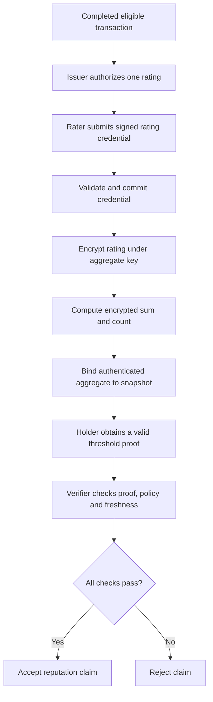

# CipherRep

**A language-neutral protocol for portable, privacy-preserving reputation.**

CipherRep aims to let people prove claims such as **“my reputation is at least 90/100 based on at least 20 eligible ratings”** without publishing their individual ratings, transaction history, or exact score.

> **Status: specification draft, not a working cryptographic implementation.** No security, privacy, or interoperability guarantees are claimed yet. In other words, this is still just an idea.

## el5

Imagine collecting sealed scorecards after doing business with people. Nobody looking at your scorecards can read them. A special calculator can add up the sealed scores, and you can show another shop a mathematical certificate that says *“my average is high enough”* without showing the scorecards. The shop can check that certificate independently. CipherRep defines the rules that would make such a system possible.

The hard part is also proving the scorecards were issued for real eligible transactions and were not copied, omitted, or invented. The design explicitly addresses those requirements.

## Who uses it? Whos it for?

- **Rater:** issues an authenticated rating after an eligible transaction.
- **Issuer/platform:** attests eligibility and rating policy, without necessarily learning future presentations.
- **Holder:** collects credentials and requests reputation proofs.
- **Aggregator:** computes authenticated encrypted aggregates under an explicitly defined trust model.
- **Verifier:** checks a claim locally against a trusted policy and freshness requirements.

## Workflow

See [workflow diagrams](spec/workflows.md) for individual roles and trust boundaries.

## Specification

- [Language-neutral protocol draft](spec/protocol.md)
- [Workflow diagrams](spec/workflows.md)
- [Threat model](spec/threat-model.md)
- [Interoperability and conformance](spec/conformance.md)

## Design principles

1. **No mandatory programming language, blockchain, central identity provider, or hosted service.**
2. **Independent verification:** verifiers can check proofs offline using public parameters and authenticated trust material.
3. **Cryptographic agility with explicit suite identifiers:** no silent algorithm substitutions.
4. **Minimal disclosure:** threshold and policy statements rather than exact rating histories.
5. **Authenticated input sets:** encrypted arithmetic alone is not evidence of honest ratings.
6. **Privacy by design:** no stable global identifier in routine presentations; use domain-separated context.
7. **Open interoperability:** canonical encodings, test vectors, and a conformance suite before a stable v1 release.

## Implementation roadmap

Rust reference core → WebAssembly/TypeScript SDK → Python and Go adapters → C ABI → optional EVM verifier. Implementations are **planned**, not available.

## Development

This repository currently contains documentation only. See the specification for unresolved cryptographic decisions. Contributions should include threat-model impact, test vectors, and clear compatibility implications. Do not use experimental implementations to make consequential trust or financial decisions without independent security review.

## License

License has not yet been selected.
