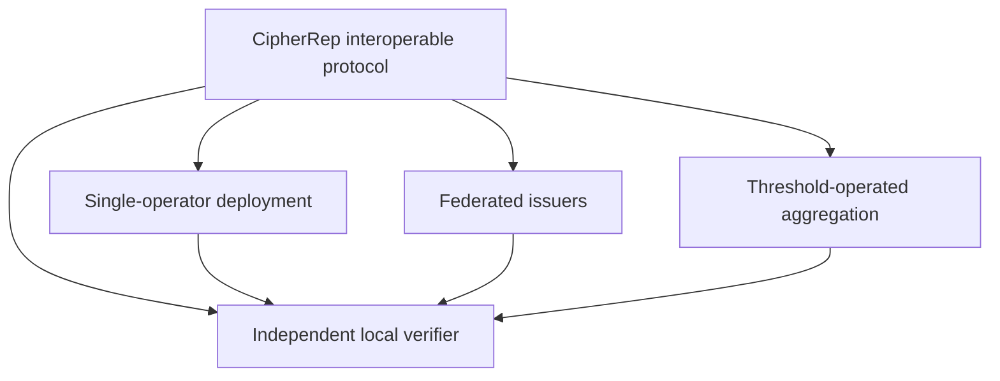

# Deployment topology

> Conceptual workflow only. Exact protocol semantics, security properties and deployment choices remain undecided.

See [protocol specification](../../spec/protocol.md), [architecture](../../ARCHITECTURE.md), and [trust model](../../spec/trust-model.md).
