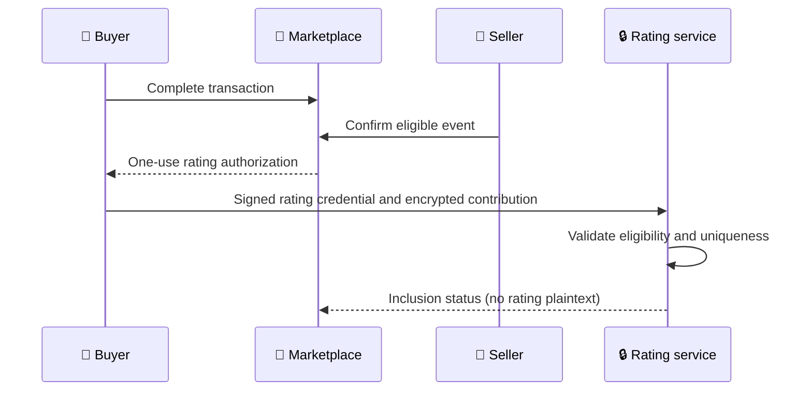

# Transaction to rating

> **Conceptual diagram — implementation-independent.** This is intended behavior, not a claim that cryptographic construction or deployment choices have been finalized.

## Visual legend

- 👤 Individual user, rater or holder
- 🏪 Marketplace or issuer
- 👥 Group or organization
- 🤝 Escrow or trading service
- 🔒 Encrypted or privacy-sensitive computation
- 🗂️ Authenticated data or snapshot
- 🛡️ Independent verifier or security check
- 📜 Specification or policy
- 🧪 Testing and conformance
- 👩‍💻 Developer
- ⚙️ Configuration or compatibility
- ✅ Accepted / ❌ Rejected / ❔ Indeterminate

Icons are **generic visual cues**, not claims of a specific UI, algorithm, trust model or deployed service. Emoji rendering varies by platform; labels remain readable without the pictograms.

See [protocol](../../../spec/protocol.md), [implementation plan](../../../PLAN.md), and [decision register](../../decision-register.md). For exact normative semantics, defer to the finalized versioned protocol and its conformance tests.
