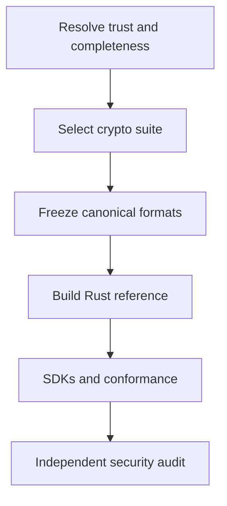

# Implementation roadmap

> **Status:** Planning draft; not a finalized normative specification or implemented feature.

## Purpose

Define milestones, dependencies, acceptance criteria and release gates.

## Proposed design

Phase 0 architecture decisions; Phase 1 normative format and suites; Phase 2 reference Rust verifier; Phase 3 proving and aggregation; Phase 4 WASM/TS; Phase 5 independent conformance; Phase 6 external audit.

## Conceptual diagram

## Decisions required

- Define the exact trust assumptions and verifier-visible inputs.
- Select canonical serialization, algorithms and parameters where applicable.
- Define failure cases, privacy leakage, and independent test vectors.
- Record the accepted design in an ADR before treating this as normative.

## Acceptance criteria

- Reviewable specification with explicit MUST/SHOULD requirements once finalized.
- Positive and negative cross-language conformance fixtures.
- Documented threat-model implications and versioning.

See [protocol draft](../spec/protocol.md) and [threat model](../spec/threat-model.md) where applicable.
