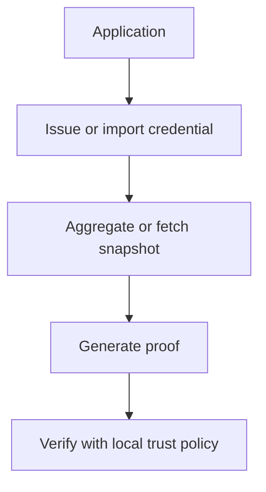

# Language-neutral API contract

> **Status:** Planning draft; not a finalized normative specification or implemented feature.

## Purpose

Specify issue, encrypt, aggregate, prove and verify operations independently of language.

## Proposed design

Define deterministic errors, cancellation, resource limits, input validation, bytes vs objects, and strict verifier results. No production API exists yet.

## Conceptual diagram

## Decisions required

- Define the exact trust assumptions and verifier-visible inputs.
- Select canonical serialization, algorithms and parameters where applicable.
- Define failure cases, privacy leakage, and independent test vectors.
- Record the accepted design in an ADR before treating this as normative.

## Acceptance criteria

- Reviewable specification with explicit MUST/SHOULD requirements once finalized.
- Positive and negative cross-language conformance fixtures.
- Documented threat-model implications and versioning.

See [protocol draft](../spec/protocol.md) and [threat model](../spec/threat-model.md) where applicable.
