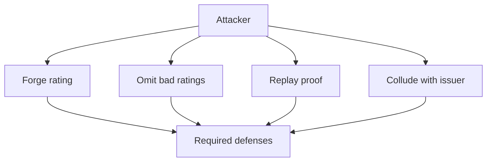

# Attack scenarios

> **Status:** Planning draft; not a finalized normative specification or implemented feature.

## Purpose

Document malicious holder, colluding issuers, forged ciphertext, omitted negatives, replay and threshold probing.

## Proposed design

Each scenario needs adversary capability, exploited trust assumption, observable outcome, detection, mitigation and regression test.

## Conceptual diagram

## Decisions required

- Define the exact trust assumptions and verifier-visible inputs.
- Select canonical serialization, algorithms and parameters where applicable.
- Define failure cases, privacy leakage, and independent test vectors.
- Record the accepted design in an ADR before treating this as normative.

## Acceptance criteria

- Reviewable specification with explicit MUST/SHOULD requirements once finalized.
- Positive and negative cross-language conformance fixtures.
- Documented threat-model implications and versioning.

See [protocol draft](../spec/protocol.md) and [threat model](../spec/threat-model.md) where applicable.
