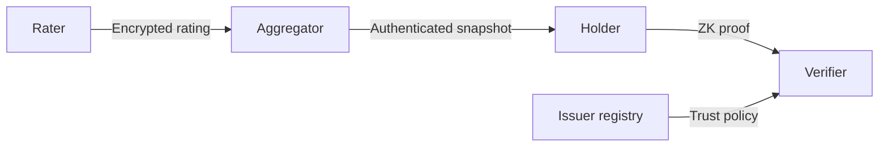

# Privacy leakage matrix

> **Status:** Planning draft; not a finalized normative specification or implemented feature.

## Purpose

Track who learns exact score, count, issuer set, domain, epoch, metadata and correlation identifiers.

## Proposed design

For each role and operation mark public, hidden, conditional or unknown. Include network-level metadata and multi-query leakage.

## Conceptual diagram

## Decisions required

- Define the exact trust assumptions and verifier-visible inputs.
- Select canonical serialization, algorithms and parameters where applicable.
- Define failure cases, privacy leakage, and independent test vectors.
- Record the accepted design in an ADR before treating this as normative.

## Acceptance criteria

- Reviewable specification with explicit MUST/SHOULD requirements once finalized.
- Positive and negative cross-language conformance fixtures.
- Documented threat-model implications and versioning.

See [protocol draft](../spec/protocol.md) and [threat model](../spec/threat-model.md) where applicable.
