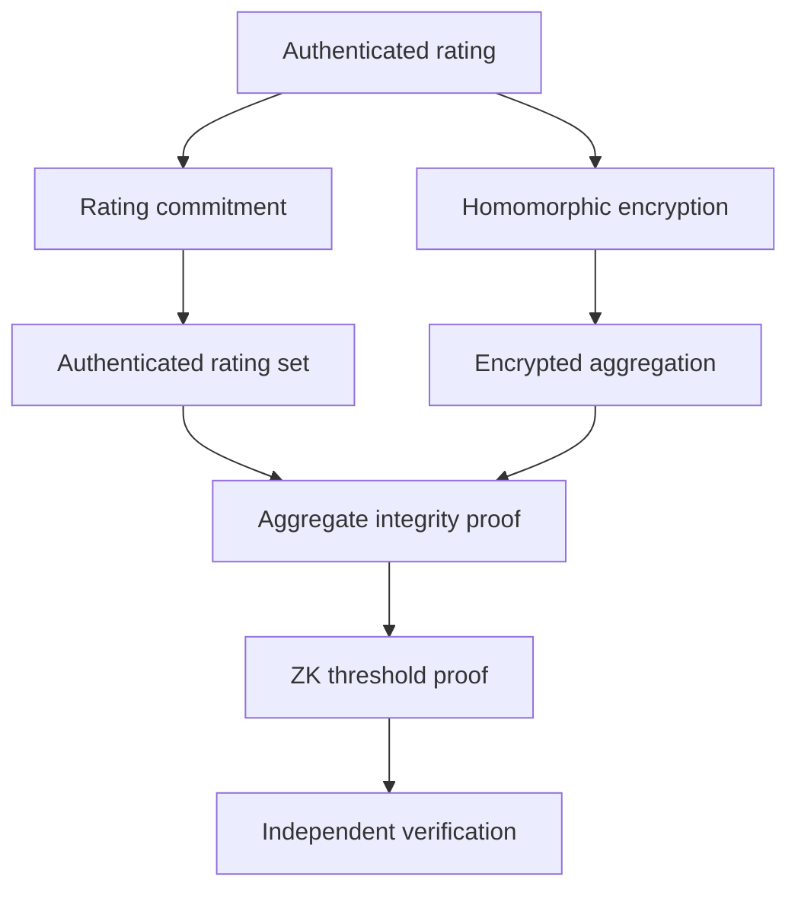

# Cryptographic construction

> **Status:** Planning draft; not a finalized normative specification or implemented feature.

## Purpose

Compare threshold Paillier, proof-friendly commitments, and other encrypted aggregation constructions.

## Proposed design

Define plaintext/ciphertext consistency, eligible set completeness, aggregate binding, setup, zero-knowledge and soundness; benchmark proof costs before choosing.

## Conceptual diagram

## Decisions required

- Define the exact trust assumptions and verifier-visible inputs.
- Select canonical serialization, algorithms and parameters where applicable.
- Define failure cases, privacy leakage, and independent test vectors.
- Record the accepted design in an ADR before treating this as normative.

## Acceptance criteria

- Reviewable specification with explicit MUST/SHOULD requirements once finalized.
- Positive and negative cross-language conformance fixtures.
- Documented threat-model implications and versioning.

See [protocol draft](../spec/protocol.md) and [threat model](../spec/threat-model.md) where applicable.
