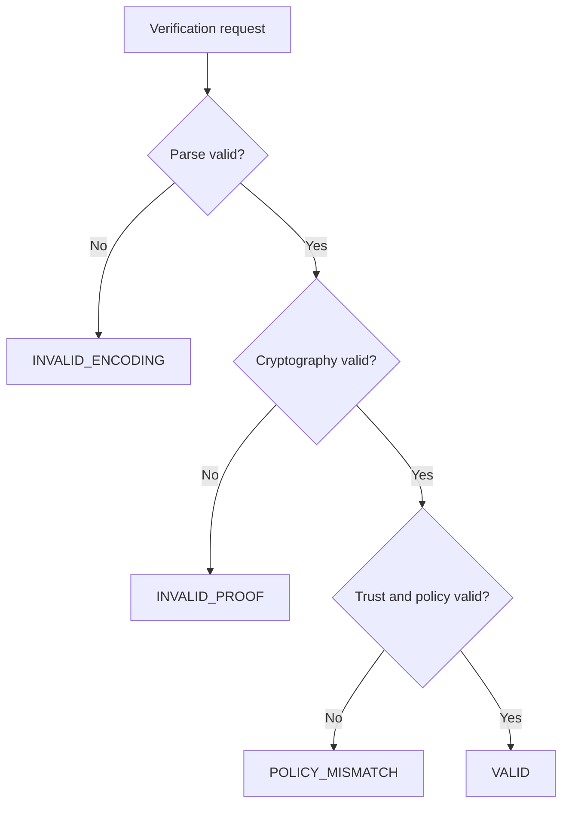

# Error taxonomy

> **Status:** Planning draft; not a finalized normative specification or implemented feature.

## Purpose

Standardize parsing, cryptographic, policy, trust, freshness and network errors.

## Proposed design

Draft categories: INVALID_ENCODING, UNSUPPORTED_VERSION, UNSUPPORTED_SUITE, INVALID_SIGNATURE, INVALID_PROOF, POLICY_MISMATCH, STALE_SNAPSHOT, REVOKED, DUPLICATE_AUTHORIZATION, INDETERMINATE.

## Conceptual diagram

## Decisions required

- Define the exact trust assumptions and verifier-visible inputs.
- Select canonical serialization, algorithms and parameters where applicable.
- Define failure cases, privacy leakage, and independent test vectors.
- Record the accepted design in an ADR before treating this as normative.

## Acceptance criteria

- Reviewable specification with explicit MUST/SHOULD requirements once finalized.
- Positive and negative cross-language conformance fixtures.
- Documented threat-model implications and versioning.

See [protocol draft](../spec/protocol.md) and [threat model](../spec/threat-model.md) where applicable.
