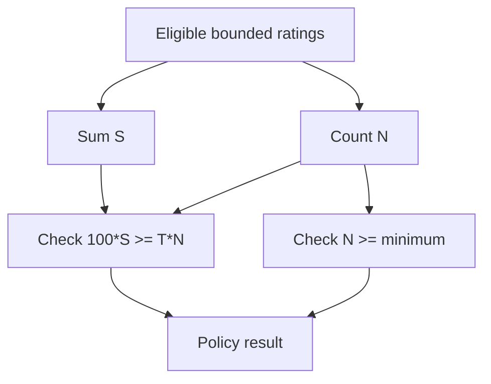

# Reputation arithmetic

> **Status:** Planning draft; not a finalized normative specification or implemented feature.

## Purpose

Define integer scores, thresholds, minimum sample count, overflow bounds and domain-specific aggregation.

## Proposed design

Initial draft: integer ratings 0..100; N>0; N>=M; 100*S>=T*N. Clarify the definition of a complete rating set and avoid floating-point consensus.

## Conceptual diagram

## Decisions required

- Define the exact trust assumptions and verifier-visible inputs.
- Select canonical serialization, algorithms and parameters where applicable.
- Define failure cases, privacy leakage, and independent test vectors.
- Record the accepted design in an ADR before treating this as normative.

## Acceptance criteria

- Reviewable specification with explicit MUST/SHOULD requirements once finalized.
- Positive and negative cross-language conformance fixtures.
- Documented threat-model implications and versioning.

See [protocol draft](../spec/protocol.md) and [threat model](../spec/threat-model.md) where applicable.
