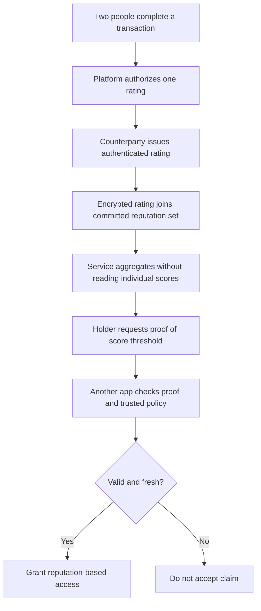
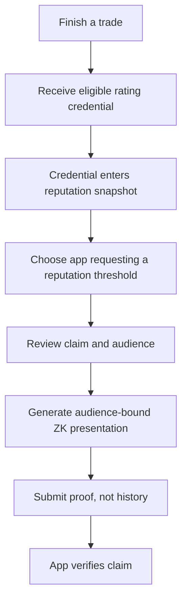
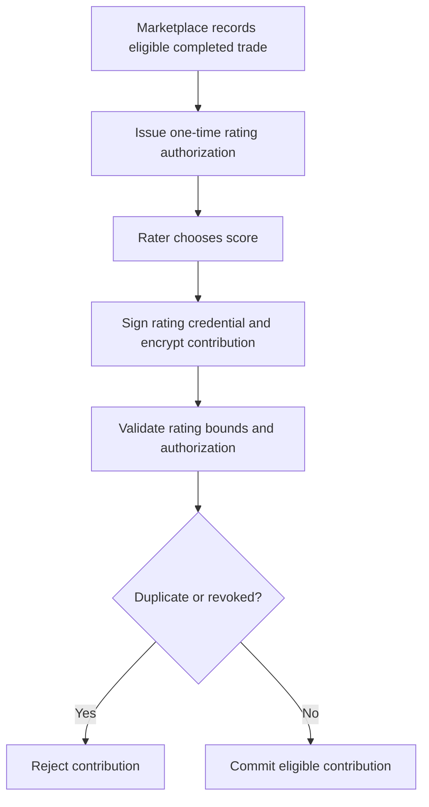
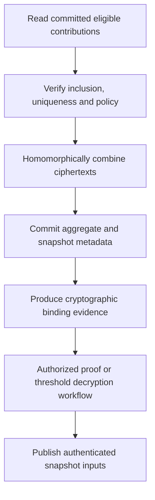
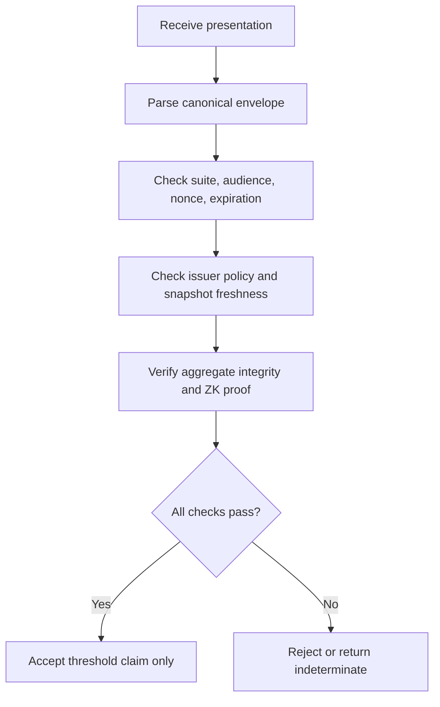
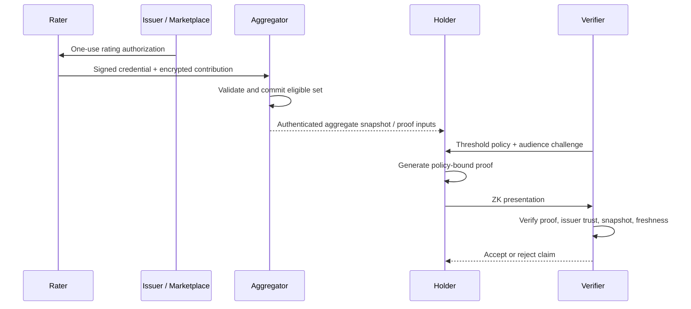

# CipherRep — Reader-Friendly Workflow Diagrams

These diagrams describe the **intended protocol**, not deployed functionality. They deliberately show the roles separately, even when one application operates multiple roles.

## 1. First-time viewer: what happens?

## 2. Customer / reputation holder journey

The holder does not automatically control which eligible ratings count; snapshot completeness must be independently enforceable.

## 3. Rater and issuing marketplace journey

## 4. Aggregator and key custodians

**Trust boundary:** encrypted arithmetic alone cannot certify which ratings were included. A cryptographic link to the authenticated snapshot and a verifiable completeness policy are required. Custodians must not be assumed incapable of colluding.

## 5. Independent verifier journey

## 6. Sequence: separation of responsibilities

## 7. What the verifier learns

| Intended disclosure | Hidden unless policy explicitly reveals it |
|---|---|
| Threshold met, minimum count met | Exact score and individual ratings |
| Domain and policy ID | Individual transaction history |
| Snapshot epoch and cryptographic suite | Counterparties and rating content |
| Trusted issuer policy / root | Holder's unrelated platform identities |

This privacy goal depends on the chosen cryptographic suite and deployment metadata. A proof alone cannot conceal IP addresses, network timing, or a globally identifying issuer policy.
